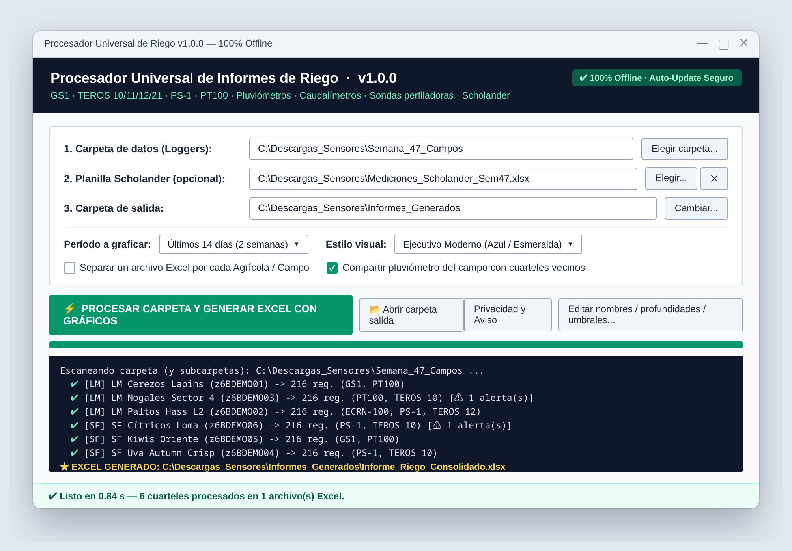
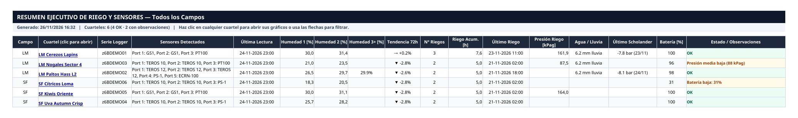
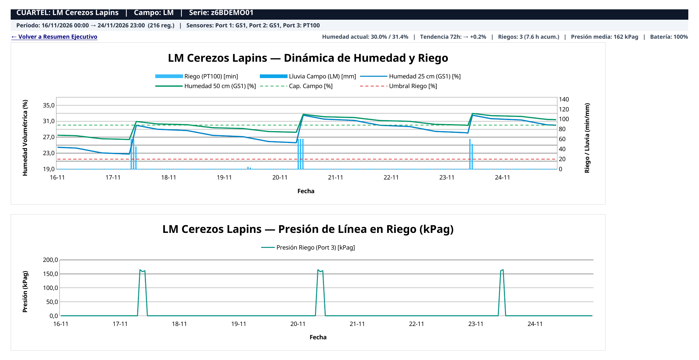
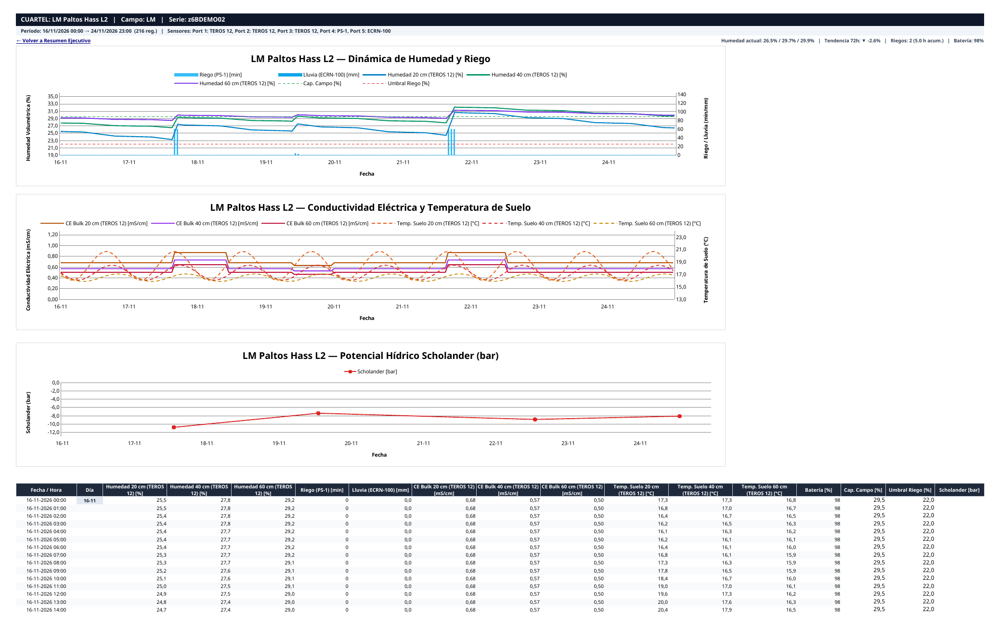

# 🌱 Procesador Universal de Informes de Riego

**Convierte carpetas completas de dataloggers agrícolas + planillas Scholander en informes ejecutivos Excel con gráficos nativos en 1 clic.**

[-0284C7?style=for-the-badge)](#vista-general-del-programa)

 

> 🔒 **Actualmente en validación cerrada con asesores agrícolas.** Próximamente descarga pública de Versión Demo + Licencias de Temporada.

---

## 🖥️ Vista general del programa

---

## 🚀 Mini-Tutorial: Cómo generar tus informes en 3 pasos

### Paso 1 — Abre el programa
1. Guarda `ProcesadorRiegoUniversal_Windows.exe` en tu Escritorio o en tu carpeta de trabajo.
2. Haz doble clic para abrirlo y activa tu licencia en el equipo.

> [!NOTE]
> **Primera ejecución en Windows:** Como es un ejecutable autónomo independiente, la primera vez que lo abras Windows puede mostrar una ventana azul (*"Windows protegió su PC"*). Solo haz clic en **«Más información»** → **«Ejecutar de todas formas»** (ocurre únicamente la primera vez).

### Paso 2 — Selecciona tu carpeta de descargas
1. En **`1. Carpeta de datos (Loggers)`**, elige la carpeta donde guardaste los archivos `.xlsx` o `.csv` descargados de tus equipos (incluso si están organizados dentro de subcarpetas por fundo o campo).
2. *(Opcional)* En **`2. Planilla Scholander`**, selecciona tu Excel o CSV con mediciones manuales de bomba Scholander (`Fecha`, `Cuartel` o `Serie`, `Potencial`).
3. Elige el **`Período a graficar`** (*Todo el historial*, *Últimos 7*, *14*, *21* o *30 días*) y si prefieres **1 libro consolidado** o **1 archivo Excel separado por cada Agrícola / Campo**.

### Paso 3 — Procesa en 1 clic
Haz clic en el botón verde **⚡ `PROCESAR CARPETA Y GENERAR EXCEL CON GRÁFICOS`**. En **menos de 2 segundos** tendrás tus libros `.xlsx` terminados, formateados en horizontal A4 y listos para enviar o imprimir en PDF.

---

## 📊 ¿Qué incluye el informe Excel generado?

### 1. Portada de Resumen Ejecutivo interactiva
Consolida todos los cuarteles en una sola vista con hipervínculos directos a cada hoja, lecturas actuales de humedad por profundidad, **tendencia hídrica de las últimas 72 h** (`▲`, `▼`, `→`), **conteo real de eventos de riego** (descartando purgas breves de tubería), presión media en línea, lluvia acumulada, último Scholander, batería y **alertas automáticas** destacables con autofiltros:

---

### 2. Curvas horarias de Humedad, Riego, Umbrales y Presión de Línea
Cada cuartel incluye una franja superior de indicadores (KPIs) y gráficos nativos editables de Excel a ancho completo, alineando al minuto los pulsos de riego/lluvia con la respuesta de las sondas de humedad, líneas de **Capacidad de Campo / Umbral de Riego** y transductores de presión (`kPag`):

---

### 3. Adaptación automática a sensores de 3 pinchos (`TEROS 12`) y Bomba Scholander
Si un datalogger tiene sensores multiparámetro o planilla Scholander asociada, el programa agrega automáticamente los paneles de **Conductividad Eléctrica + Temperatura de Suelo** y **Potencial Hídrico Xilemático**, seguidos de la tabla horaria completa con autofiltros:

---

## 🔌 Sensores y configuraciones compatibles sin programar nada

El motor identifica cada canal por **magnitud física** (sin importar en qué puerto esté conectado ni si hay puertos vacíos entre medio):

| Categoría | Sensores / Formatos reconocidos automáticamente | Salida en el informe |
| :--- | :--- | :--- |
| **Humedad de suelo** | `GS1`, `TEROS 10`, `TEROS 11`, `TEROS 12`, `EC-5`, `10HS`, `5TE`, `GS3` y sondas perfiladoras | Conversión `m³/m³` → `%` y curvas por profundidad |
| **Salinidad y Temp. suelo** | Sensores de 3 pinchos (`TEROS 12`, `GS3`, `5TE`) | Gráfico adicional de `CE` (`mS/cm` o `dS/m`) + `°C` |
| **Potencial mátrico** | `TEROS 21`, `MPS-6` | Curva de tensión mátrica en `kPa` |
| **Tiempo y presión de riego** | Presostatos `PS-1` y transductores `PT100` | Barras de riego (`min`), gráfico `kPag` y alerta `< 100 kPag` |
| **Agua aplicada / Lluvia** | Caudalímetros (`L`, `mm`, pulsos) y pluviómetros `ECRN-50` / `ECRN-100` | Barras secundarias y lluvia compartible entre cuarteles vecinos |
| **Potencial xilemático** | Planillas manuales `.xlsx` o `.csv` de **Bomba Scholander** | Emparejamiento automático por cuartel/serie y gráfico `bar`/`MPa` |
| **Cambios a mitad de temporada** | Múltiples hojas `Processed Data Config 1`, `Config 2`… | Fusión cronológica continua y limpieza de errores (`-999`) |

---

## ⚙️ Personalización por Número de Serie (se guarda sola)

Desde el botón **`Editar nombres / profundidades / umbrales...`** puedes asignar una sola vez para cada número de serie de datalogger:
- **Campo / Agrícola** y **Nombre personalizado del cuartel**.
- **Profundidades de cada puerto** (ej. `20 cm, 40 cm, 60 cm`) para que aparezcan directo en las leyendas.
- **Capacidad de Campo (`%`)** y **Umbral de Riego (`%`)** para trazar las líneas punteadas de referencia y activar alertas en el resumen.

Toda esta configuración queda guardada localmente en `config_loggers.json` junto a tu `.exe` para todas las semanas siguientes.

---

## 🔒 Privacidad y Actualizaciones Automáticas

- **100% Privacidad Local:** Ningún archivo Excel, nombre de campo, serie ni dato agronómico sale de tu computador. El programa funciona completamente **sin internet** en terreno.
- **Actualización en 1 clic:** Cuando abres el programa conectado a internet, verifica silenciosamente si existe una versión nueva publicada en este repositorio. Si hay mejoras disponibles, aparecerá arriba a la derecha el botón **`⬇ Actualizar`**, que verifica la firma criptográfica `SHA-256` y actualiza el `.exe` conservando intactas todas tus configuraciones.
